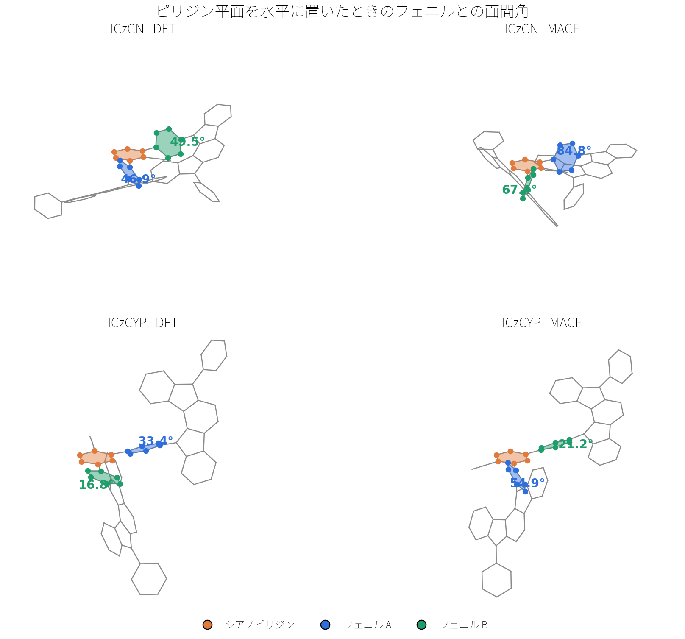
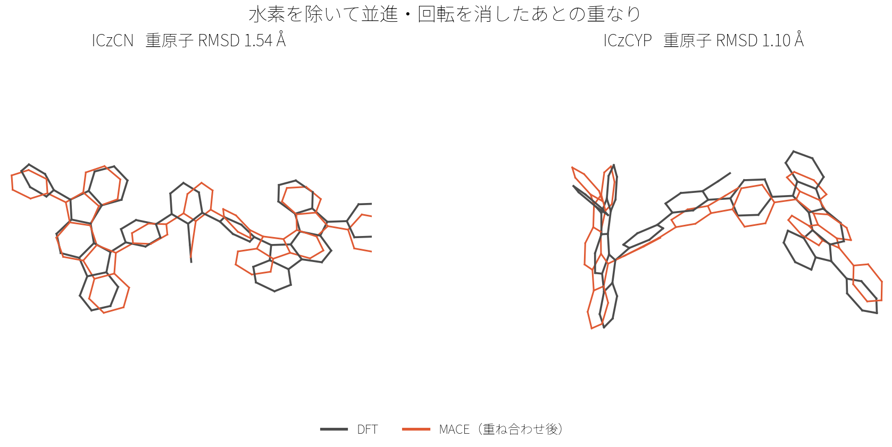
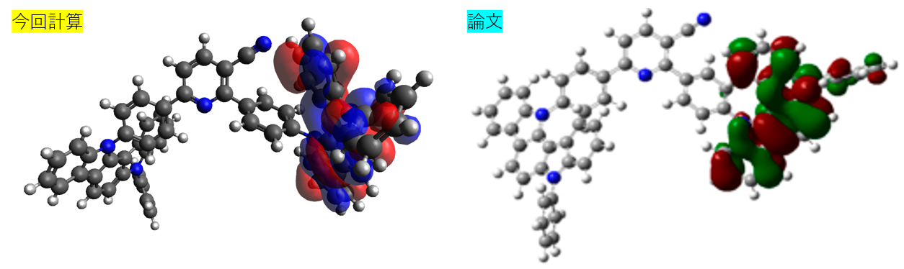
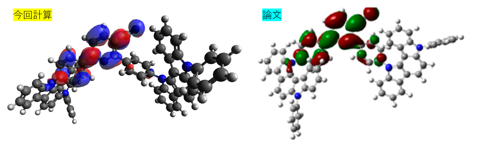

# GPUを使ったDFT計算

English version: [README_EN.md](README_EN.md)

## 要約
本リポジトリでは、2次元の分子構造情報である「SMILES」文字列を入力として受け取り、初期立体構造の生成から高精度な量子化学計算（構造最適化およびTD-DFTによる励起状態計算）までを全自動でバッチ処理するコードを提供します。GPUアクセラレーションを活用することで、ハイスループットなスクリーニングを可能にしています。

量子化学計算ができるpythonのライブラリを以前使ってみたのですが、なかなか計算が終わらず困っていました。そこでGPUを使って計算を高速化できないか検討した結果となります。今回使用する、`gpu4pyscf`を使うと分子量がある程度大きい分子でも（もちろん限界はありますが）、問題なくDFT計算が実行できたのでその手順をまとめておきます。

## 実行環境の構築 (Environment Setup)
本コードは `conda`（または `mamba` / `micromamba`）を使用して、依存関係の競合なく簡単に実行環境を再現することができます。NVIDIA のドライバ（CUDA 12 が使えるもの）は別途必要です。

```bash
# 1. リポジトリをクローンして、そのディレクトリへ移動する
git clone https://github.com/K-Yuta1014/How-to-use-gpu4pyscf.git
cd How-to-use-gpu4pyscf

# 2. environment.yml を用いて conda 環境を作成
conda env create -f environment.yml

# 3. 環境を有効化
conda activate gpu4pyscf

# 4. リポジトリのルートで Jupyter を起動する
jupyter lab
```

これだけで、PySCF, GPU4PySCF, MACE, cuTENSOR等の必要なライブラリが全てインストールされます。ノートブック内の `data/` や `output/` は、クローンしたディレクトリからの相対パスです。`jupyter lab` はそのディレクトリで起動してください。

## 入力データの形式 (Input Data Format)
計算を開始するためには、あらかじめ `data/` ディレクトリ内にバッチ処理したい化合物のリストをまとめたCSVファイルを配置する必要があります。CSVファイルは以下の2つの列を最低限含んでいる必要があります。列の順番はどちらが先でも構いません。

- **`material` (または `index`)**: 化合物を識別するためのIDや名前（例: `BTD1`, `1`, `OLED_Material_A` など）。この文字列がそのまま出力先のフォルダ名やログファイル名に利用されます。
- **`SMILES`**: 計算対象の分子構造を表すSMILES文字列（例: `C=1C=CC=CC1`）。

**CSVの例 (`data/input_materials.csv`)**:
```csv
material,SMILES
benzene,C=1C=CC=CC1
BTD1,CC1(C)C2=CC(C3=C(N=S=N4)...
```

## ノートブックの説明

### 1. `dft_sandbox.ipynb` (通常のDFT構造最適化 / バッチ処理)
PySCF（GPU4PySCF）を用いて、純粋な第一原理計算（DFT）で構造最適化から励起状態計算までを一貫して行うバッチ処理ワークフローです。
- **目的**: 多数の分子の物性（HOMO/LUMO/S1/T1/f値など）を一気にスクリーニングすること。
- **使い方**: `data/` フォルダのCSVを読み込ませてセルを実行。
- **出力**: `output/` フォルダ内に、各分子の座標(`_opt.xyz`)、`.molden`、`.fchk`、HOMO/LUMO の Cube、物性一覧の CSV が生成されます。

#### [使用例]

まず、`data/` フォルダに計算したい化合物のリストをまとめたCSVファイルを配置します。

HOMO, LUMO, S1などの情報が載っている分子がオープンソースの論文に記載されていましたので、こちらを計算してみます。
(Choi, M.G.; Lee, C.H.; Adachi, C.; Lee, S.Y. Highly Effective Thermally Activated Delayed Fluorescence Emitters Based on Symmetry and Asymmetry Nicotinonitrile Derivatives. Molecules 2022, 27, 8274. https://doi.org/10.3390/molecules27238274)

**CSVの例 (`data/test_dft.csv`)**:
```csv
material,SMILES
ICzCN,C=1C(N2C3=CC=CC=C3C4=...
ICzCYP,C1=2C=3C(=CC=CC3)N(C1=...
```

そして、ノートブックのセル[2]をこのようにします。入力のcsvファイル名と、結果を記載する出力用のcsvファイル名を決めてください。
```python
# 2. データセットの読み込み
csv_path = 'data/test_dft.csv'
# 結果を保存（および再開）するCSVファイルのパス
output_csv = 'output/test_dft_results.csv'

df = pd.read_csv(csv_path)
print(f"読み込まれた化合物数: {len(df)}")
df.head()
```

セル[3]以降はそのまま実行していただき、セル[5]で計算条件を決めます。論文に合わせて、`B3LYP/6-31G(d)`にしましょう。

```python
# 5. Batch process the dataset
XC_FUNCTIONAL = 'b3lyp'
BASIS_SET = '6-31g*'
```
gpu4pyscfでは様々な汎関数、基底関数が使用できるみたいです。分散関数・分極関数の指定もできます。

セル[6]以降を実行すると、DFT計算が始まります。     
計算が無事に終わったら、出力されるcsvに結果が表示されます。

今回 B3LYP/6-31G(d)、`grids.level = 3` で計算した HOMO、LUMO、S1、T1、振動子強度 f と論文の値を比較します。エネルギーは eV です。数値は `output/test_dft_results.csv` を小数第3位で丸めたものです。

| 分子 | 出典 | HOMO | LUMO | S1 | T1 | f |
| --- | --- | ---: | ---: | ---: | ---: | ---: |
| ICzCN | 論文 Fig. 1 | −5.02 | −2.16 | 2.50 | 2.49 | 0.0043 |
| ICzCN | 今回 | −5.074 | −2.153 | 2.577 | 2.562 | 0.0138 |
| ICzCYP | 論文 Fig. 1 | −4.97 | −2.16 | 2.48 | 2.46 | 0.0076 |
| ICzCYP | 今回 | −5.006 | −2.167 | 2.509 | 2.462 | 0.0074 |

ICzCYP は T1 と f が論文値に揃っています。LUMO の差はどちらの分子も 0.01 eV 程度です。HOMO は ICzCN で 0.05 eV、ICzCYP で 0.04 eV 低く、S1 は ICzCN で 0.08 eV 高く出ています。f が大きくずれているのは ICzCN だけです。積分グリッドは PySCF の標準（`level = 3`）なので、残る差は J・K の RI 近似と、受容体周りのねじれ角の違いによるものと考えています。

軌道の分布を見てみましょう。

[**ICzCYP_HOMO**]


[**ICzCYP_LUMO**]


HOMOはカルバゾールに局在化しており、LUMOは中央のシアノピリジン＋フェニルに局在化しています（若干カルバゾールのN原子にも）。     
この結果も論文と一致しています。

### 2. `mace_sandbox.ipynb` (MACEを用いた高速最適化 / バッチ処理)
機械学習ポテンシャルである **MACE (MACE-OFF23)** で構造最適化を短時間に行い、その構造のまま GPU4PySCF で電子状態を計算するワークフローです。

- **目的**: より巨大なデータセットの1次スクリーニング。構造最適化にかかる時間を大幅に短縮します。
- **使い方**: `dft_sandbox.ipynb` と同様。
- **出力**: `output_mace/` に `_opt.xyz`、`.log`、`.fchk`、`.molden`、HOMO/LUMO の Cube、物性一覧の CSV。
- **注意**: ホウ素(B)などの一部の非対応元素が含まれる分子はエラー（`fail`）となるため、通常の `dft_sandbox.ipynb` で補完する必要があります。

同じ2分子を比べています。違うのは構造最適化だけで、電子状態はどちらも B3LYP/6-31G(d)、`grids.level = 3`、J・K とも RI 近似です。MACE 側の構造は MACE-OFF23 です。エネルギーは eV で、小数第3位に丸めています。DFT の計算時間は、構造最適化から TD-DFT までの全工程です。直近の DFT 再計算は最適化済みの xyz を再利用したので、CSV の経過時間（ICzCN 2時間52分、ICzCYP 2時間59分）は単点計算と TD-DFT だけです。MACE の計算時間は、`grids.level = 3` で構造最適化から TD-DFT まで通した時間です。

| 分子 | 構造最適化 | HOMO | LUMO | S1 | T1 | f | 計算時間 |
| --- | --- | ---: | ---: | ---: | ---: | ---: | ---: |
| ICzCN | DFT | −5.074 | −2.153 | 2.577 | 2.562 | 0.0138 | 7時間23分 |
| ICzCN | MACE | −5.079 | −1.924 | 2.811 | 2.803 | 0.0037 | 2時間57分 |
| ICzCYP | DFT | −5.006 | −2.167 | 2.509 | 2.462 | 0.0074 | 7時間32分 |
| ICzCYP | MACE | −4.962 | −2.038 | 2.594 | 2.589 | 0.0017 | 3時間2分 |

HOMO は 0.05 eV 以内に収まっていますが、LUMO、S1、f はかなりずれています。MACE-OFF23 の small、medium、large はモデルの大きさの違いで、学習している計算レベルはいずれも ωB97M-D3(BJ)/def2-TZVPPD です。分散力を含み、基底関数も def2-TZVPPD なので、分散なしの B3LYP/6-31G(d) とは安定構造が異なるため、このようなずれが生じると推測しています。

今回の2分子では、シアノピリジンと、そこに単結合で付いた2つのフェニルとの面間角が次のように開いていました。

| 分子 | DFT 最適化 | MACE-OFF23 |
| --- | --- | --- |
| ICzCN | 46.9°、49.5° | 84.8°、67.4° |
| ICzCYP | 33.4°、16.8° | 54.9°、21.2° |

RDKit でシアノ基の付いたピリジンと、そのピリジンに単結合でつながる2つのフェニルを拾い、各6員環の6原子に最小二乗平面を当てました。角度は2つの平面の法線がなす角で、0°が同一平面、90°が直交です。符号は付けていません。下の図は、ピリジン平面を水平に置いたものです。



重原子の RMSD は、水素を除いた原子について、2つの構造を並進と回転で最も重なる向きに合わせたあとの、対応する原子間距離の二乗平均平方根です。ICzCN で 1.54 Å、ICzCYP で 1.10 Å あり、結合長のずれ（0.01 Å 程度）ではなく、環の向きが違っていることを示します。



MACE 構造を同じ B3LYP/6-31G(d) で単点評価すると、DFT 最適化構造より ICzCN で 9.2 kcal/mol、ICzCYP で 8.4 kcal/mol 高くなります。HOMO はドナー側にあり動きにくい一方、LUMO と S1、弱い電荷移動遷移の f は、このねじれに敏感です。ICzCYP の ΔEST も 0.047 eV から 0.004 eV に縮んでいます。

改めて軌道の分布を見てみましょう。

[**ICzCYP_HOMO_MACE**]



[**ICzCYP_LUMO_MACE**]



軌道の分布形式は先ほどのDFTの結果と概ね一致していますが、LUMOに関してはフェニルリンカーの局在が弱まっており、中央のシアノピリジンに収まっています。よって、共役が伸びていないことから、LUMOが浅くなることが予想され計算結果とも一致しています。

但し、計算時間は DFT の約3分の1なので、候補を広くすくうスクリーニング用途には向いています。

### 3. `dft_resp_single.ipynb` (RESP電荷・精密解析用 / 単分子)
特定の1分子に対して、分散関数(+付き)を含む高精度な基底関数を用いて構造最適化と単点計算を行うノートブックです。
- **目的**: Multiwfn等を用いたRESP電荷の計算や、精緻なESPマップの作成。TD-DFTは行わず、計算リソースを電荷解析のための電子状態計算に集中させます。
- **使い方**: MACE などで粗く最適化した xyz のパスを `xyz_path` に書いて実行する。その座標から B3LYP/6-31+G(d,p) で構造を取り直し、HF/6-31G(d) の単点計算で RESP 用の波動関数を書く。
- **出力**: `{名前}_resp_geomopt.log`、`{名前}_resp_opt.xyz`、`{名前}_resp.log`、`{名前}_resp.chk`、`{名前}_resp.fchk`、Multiwfn の RESP に渡す `{名前}_resp.molden`。

### 4. `dft_ip_reorg.ipynb` (ホール輸送物性の解析 / 単分子)
特定の1分子について、中性状態とカチオン(正電荷)状態それぞれの構造最適化と単点計算を組み合わせ、ホール輸送に関するパラメータを算出します。
- **目的**: Marcus理論に基づくホール再配列エネルギー($\lambda_h$)、垂直イオン化ポテンシャル(vIP)、断熱イオン化ポテンシャル(aIP)の算出。
- **使い方**: ノートブック内に直接SMILESを貼り付けて実行。
- **出力**: 計算結果(vIP, aIP, $\lambda_h$ 等)が記載された `result.txt` および最適化構造。

### 5. `dft_ea_reorg.ipynb` (電子輸送物性の解析 / 単分子)
上記のIP版と同様の流れで、中性状態とアニオン(負電荷)状態のエネルギー差から、電子輸送に関するパラメータを算出します。
- **目的**: 電子再配列エネルギー($\lambda_e$)、垂直電子親和力(vEA)、断熱電子親和力(aEA)の算出。
- **使い方**: ノートブック内に直接SMILESを貼り付けて実行。
- **出力**: 計算結果(vEA, aEA, $\lambda_e$ 等)が記載された `result.txt` および最適化構造。

## ディレクトリ構成

- **`data/`**
  **読み込み専用のディレクトリです。**
  計算の入力となるSMILESリストが含まれたCSVファイルを配置します。
- **`output/`**
  **結果の保存先ディレクトリです（通常版DFTおよび単分子解析）。**
  分子ごとの詳細データ（`.log`, `_geomopt.log`, `.xyz`, `.cube`, `.molden`, `.fchk`, `result.txt`）や最終的な物性値が一覧になった結果CSVがここに保存されます。`.log` は最適化構造での単点計算、`_geomopt.log` は構造最適化のログです。
- **`output_mace/`**
  **結果の保存先ディレクトリです（MACE版）。**
  `mace_sandbox.ipynb` を実行した際に生成される詳細データと、結果一覧のCSVファイルが保存されます。

## 計算の高速化について (cuTENSOR / グリッド密度 / メモリ管理)
`dft_sandbox.ipynb` と `mace_sandbox.ipynb` の積分グリッドはどちらも `grids.level = 3` です。PySCF の初期値で、Gaussian の `Integral=Fine` に近い密度です。論文との比較表と、DFT と MACE の比較表は、どちらもこの設定です。`level = 3` は VRAM と計算時間が増えるので、8GB 級の GPU では他の CUDA ジョブを止めて実行してください。

`dft_sandbox.ipynb` では、構造最適化のあと、一重項 TD-DFT のあと、そして分子が1つ終わるごとに、CuPy のメモリプールを OS へ返します。前の計算の配列が VRAM に残ったまま次へ進まないようにするためです。IP と EA のノートブックも、電荷状態を切り替えるたびに同じ解放をしています。

テンソル縮約は、NVIDIA の **cuTENSOR** を `ctypes` で先に読み込み、CuPy と GPU4PySCF から使っています。

## 引用・使用ライブラリ (Citations)

本プロジェクトは以下の強力なライブラリ群の恩恵を受けています。

- **GPU4PySCF**:
  Li, R.; Sun, Q.; Zhang, X.; Chan, G. K.-L. Introducing GPU Acceleration into the Python-Based Simulations of Chemistry Framework. *J. Phys. Chem. A* **2025**, *129*, 1459–1468. https://doi.org/10.1021/acs.jpca.4c05876
- **MACE**:
  Batatia, I.; Kovács, D. P.; Simm, G. N. C.; Ortner, C.; Csányi, G. MACE: Higher Order Equivariant Message Passing Neural Networks for Fast and Accurate Force Fields. *Advances in Neural Information Processing Systems* **2022**, *35*, 11423–11436.
- **MACE-OFF23**:
  Kovács, D. P.; Moore, J. H.; Browning, N. J.; Batatia, I.; Horton, J. T.; Pu, Y.; Kapil, V.; Witt, W. C.; Magdău, I.-B.; Cole, D. J.; Csányi, G. MACE-OFF: Short-Range Transferable Machine Learning Force Fields for Organic Molecules. *J. Am. Chem. Soc.* **2025**, *147*, 17598–17611. https://doi.org/10.1021/jacs.4c07099
- **PySCF**:
  Sun, Q.; Berkelbach, T. C.; Blunt, N. S.; Booth, G. H.; Guo, S.; Li, Z.; Liu, J.; McClain, J. D.; Sayfutyarova, E. R.; Sharma, S.; Wouters, S.; Chan, G. K.-L. PySCF: the Python-based simulations of chemistry framework. *WIREs Comput. Mol. Sci.* **2018**, *8*, e1340. https://doi.org/10.1002/wcms.1340
- **cuTENSOR**:
  NVIDIA Corporation. *cuTENSOR Library*.
- **CuPy**:
  Okuta, R., et al. "CuPy: A NumPy-Compatible Library for NVIDIA GPU Calculations." *Proceedings of Workshop on Machine Learning Systems (LearningSys)* (2017).
- **geomeTRIC**:
  Wang, L.-P., & Song, C. "Geometry optimization made simple with translation and rotation coordinates." *The Journal of Chemical Physics* 144.21 (2016): 214108.
