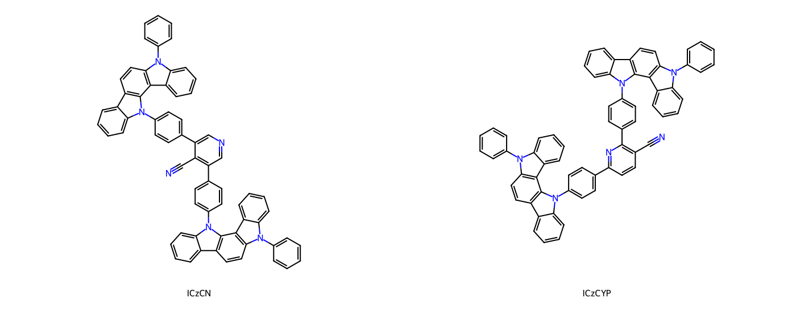
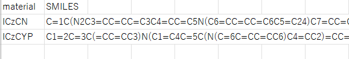
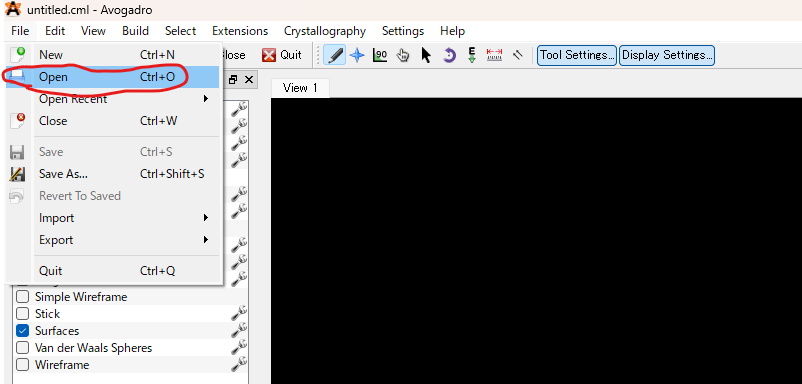
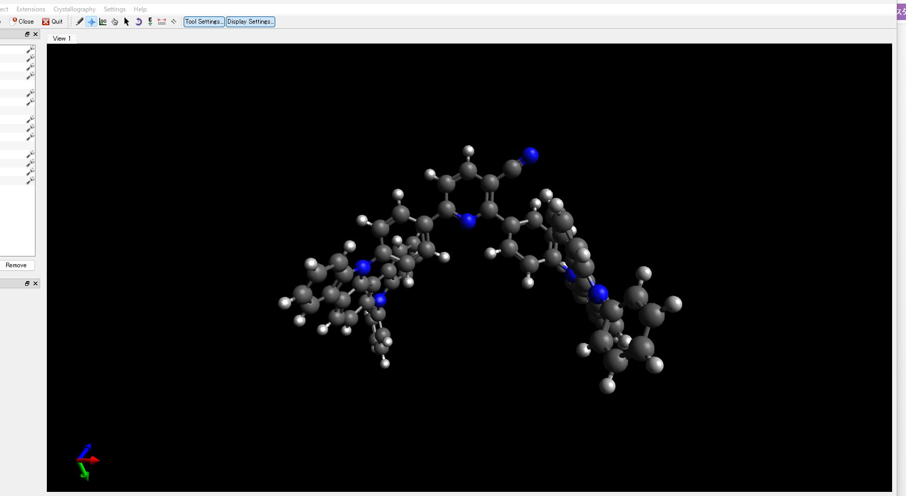
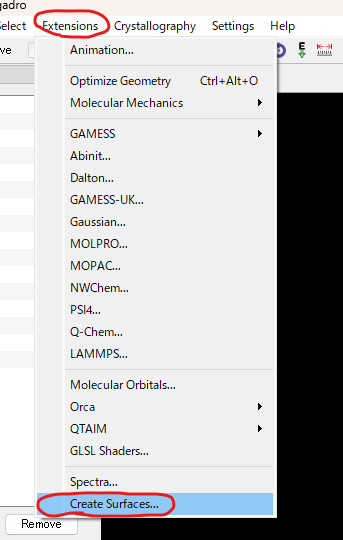
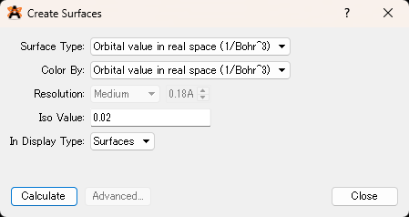
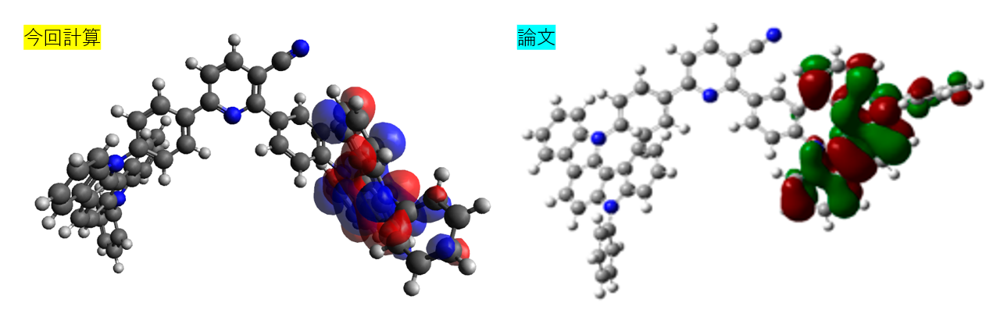
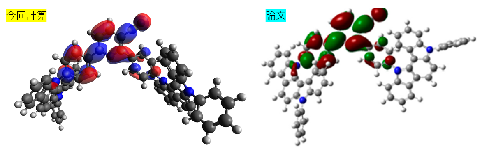

# 爆速でDFT計算を終わらせましょう
という内容で記事を書きましたが、爆速は言い過ぎでした。**それでも速いです**。以前はDFT計算のような量子化学計算は、計算serverのようなspecの高いPCでしかできないという印象でしたが、**GPUがあれば有機低分子の計算なら数時間程度で終わります**。

それでは早速やっていきましょう。
使用したpcのspecは以下の通りです。

https://qiita.com/Osarunokagoya/items/761b0d731371ed50a30e

- CPU : AMD Ryzen 5 4500
- GPU： NVIDIA GeForce RTX 4060 8GB
- メモリ：32GB (16GBx2)
- SSD：1TB NVMe SSD

そこまで高級なPCではないです。ドスパラという通販サイトで比較的廉価なpcを買いました（買った当初のお話）

使用したコードの詳細は↓GitHubに載せています。じっくり見たい方は参照ください。

https://github.com/K-Yuta1014/How-to-use-gpu4pyscf

## 一応背景
もともと「自宅のPCでも手軽に量子化学計算（DFT計算）を回したい」と思い、Pythonから手軽に扱える `Psi4` を試していました。

しかし、ベンゼンなどの小さな分子ならともかく、もう少し骨格の大きい分子を計算しようとすると、計算時間がかかりすぎて手元のCPUでは到底終わりませんでした（Ryzen 5 4500の6コア環境では、実用的な基底関数を載せると数時間〜一晩放置しても終わらないことも……）。

やはり**一般家庭向けのCPUスペックでは、本格的なDFT計算を日常的に回すのは厳しいのが現実でした**。

## 解決策：GPUで量子化学計算を回す「gpu4pyscf」
そこで行き着いたのが、GPUを使って量子化学計算を高速化するライブラリ **`gpu4pyscf`** です。

Pythonの代表的な量子化学計算パッケージ「``PySCF``」のGPU拡張版であり、**計算コストのボトルネックとなる2電子積分の評価やフォック行列の構築、交換相関項の数値積分などをGPUに代替**することで、劇的な高速化を実現しています。単一エネルギー計算（SCF）だけでなく、構造最適化に必要な勾配計算や振動解析のヘシアン計算までGPU上で動作します。

↓細かい内容を参照したい方はこちら。

https://github.com/pyscf/gpu4pyscf

https://pyscf.org/user/gpu.html

「これなら手元のRTX 4060でも実用速度で回せるのでは？」と思い、実際に環境を構築して試してみました。

## 構造最適化
それでは実際の量子化学計算をやっていきましょう。計算する分子は量子化学計算の結果が載っていて、open sourceである論文から適当に選んでみました。

「Highly Effective Thermally Activated Delayed Fluorescence Emitters Based on Symmetry and Asymmetry Nicotinonitrile Derivatives」Min Gyeong Choi et al., Molecules 2022, 27, 8274. 

https://doi.org/10.3390/molecules27238274

計算する分子はこの論文に記載されているICzCN, ICzCYPという2分子です。



GitHubにある`dft_sandbox.ipynb`を使って計算していきます。このノートブックは`material`(材料名)、`SMILES`の2列で構成されているcsvを読み込み、記載されている全ての材料のDFT計算を行うものになります。

よって、まずはこれらの2材料のsmilesが載っているcsvを用意しましょう。各材料のsmilesは以下の通りです。     
[ICzCN] :
 `C=1C(N2C3=CC=CC=C3C4=CC=C5N(C6=CC=CC=C6C5=C24)C7=CC=CC=C7)=CC=C(C1)C8=C(C(C=9C=CC(N%10C=%11C(C%12=CC=C%13N(C=%14C(C%13=C%10%12)=CC=CC%14)C=%15C=CC=CC%15)=CC=CC%11)=CC9)=CN=C8)C#N`     
[ICzCYP] : `C1=2C=3C(=CC=CC3)N(C1=C4C=5C(N(C=6C=CC=CC6)C4=CC2)=CC=CC5)C=7C=CC(=CC7)C8=C(C=CC(=N8)C=9C=CC(N%10C=%11C(=CC=CC%11)C=%12C%10=C%13C%14=CC=CC=C%14N(C%13=CC%12)C=%15C=CC=CC%15)=CC9)C#N`

これらのSMILESを記載した`test_dft.csv`を、`data`というディレクトリを作って入れておきましょう。
`data/test_dft.csv` ということです。中身はこんな感じ↓



まず必要なライブラリを読み込みます。

```python
# 標準ライブラリ
import os      # 入出力ファイルのパス操作とディレクトリ作成
import re      # 材料名をファイル名に使える文字へ置換
import time    # 分子ごとの計算時間を計測
import gc      # 計算オブジェクトを破棄し、GPUメモリを返せるようにする
import ctypes  # cuTENSORの共有ライブラリを先に読み込む

# 数値・表データ
import numpy as np   # 軌道番号や双極子モーメントなどの数値処理
import pandas as pd  # 入力CSVの読み込みと計算結果の書き出し

# 分子構造（SMILESから3次元座標を作る）
import rdkit                    # バージョン確認用
from rdkit import Chem          # SMILESの解釈、水素付加、形式電荷
from rdkit.Chem import AllChem  # 初期3次元構造の生成と力場による最適化

# GPU計算の土台
import cupy     # GPU上の配列演算。gpu4pyscfが内部で使う
import cutensor  # NVIDIA cuTENSOR本体。共有ライブラリの場所を得る
cutensor_dir = os.path.join(list(cutensor.__path__)[0], "lib")
ctypes.CDLL(os.path.join(cutensor_dir, "libcutensor.so.2"), mode=ctypes.RTLD_GLOBAL)
ctypes.CDLL(os.path.join(cutensor_dir, "libcutensorMg.so.2"), mode=ctypes.RTLD_GLOBAL)
from cupy_backends.cuda.libs import cutensor as cutensor_lib  # CuPyから使うcuTENSOR

# 量子化学計算（PySCF / GPU4PySCF）
import pyscf       # 量子化学計算の本体
import gpu4pyscf   # PySCFのGPU版。DFTとTD-DFTをGPUで実行する
import geometric   # 構造最適化エンジン geomeTRIC
from pyscf import gto  # 座標・基底関数・電荷から計算用の分子を定義
from pyscf.geomopt.geometric_solver import optimize  # geomeTRICによる構造最適化
from pyscf.tools import cubegen  # HOMO/LUMOをcubeファイルとして書き出す
from gpu4pyscf.dft import rks as dft_rks    # GPU上のDFT（基底状態のエネルギーと軌道）
from gpu4pyscf.tdscf import rks as td_rks  # GPU上のTD-DFT（励起状態 S1/T1）

print(f"RDKit バージョン: {rdkit.__version__}")
print(f"PySCF バージョン: {pyscf.__version__}")
print(f"GPU4PySCF バージョン: {gpu4pyscf.__version__}")
print(f"geomeTRIC バージョン: {geometric.__version__}")
print(f"CuPy バージョン: {cupy.__version__}")
print(f"cuTENSOR バージョン: {cutensor_lib.get_version()}")

def release_gpu():
    # 参照が切れた計算オブジェクトを回収し、CuPyが握ったままのVRAMをOSへ返す
    gc.collect()
    cupy.get_default_memory_pool().free_all_blocks()
    cupy.get_default_pinned_memory_pool().free_all_blocks()
```

使用したライブラリのversionは以下の通りです。
```markdown
RDKit バージョン: 2026.03.3
PySCF バージョン: 2.13.1
GPU4PySCF バージョン: 1.7.6
geomeTRIC バージョン: 1.1.1
CuPy バージョン: 14.1.1
cuTENSOR バージョン: 20700
```
環境構築用の`environment.yml`はGitHubに入れてますので、完全再現したい場合はそちらを使用してください。

次に、先のcsvを読み込みます。

```python
# 2. データセットの読み込み
csv_path = 'data/test_dft.csv'
# 結果を保存（および再開）するCSVファイルのパス
output_csv = 'output/test_dft_results.csv'

df = pd.read_csv(csv_path)
print(f"読み込まれた化合物数: {len(df)}")
df.head()
```
`output_csv`で出力されるcsvの名前を定義しています。

次に、DFT計算に必要な計算前の3次元座標を作る関数を定義します。これはRDKitの`MMFFOptimizeMolecule`を使います。

まず最初は、電子状態はまず考慮せずに、立体反発のみ考慮して、**粗々の3次元構造最適化を行い、それをDFT計算前の初期配座とするわけです**。

```python
# 3. SMILESから3D構造の生成を定義 (RDKit)
def smiles_to_3d_block(smiles):
    """
    SMILES文字列をPySCF用の3D座標ブロック文字列に変換します。
    戻り値: (座標文字列, 電荷) または 失敗時は (None, None)
    """
    mol = Chem.MolFromSmiles(smiles)
    if mol is None:
        return None, None
    
    # 水素原子の付加
    mol = Chem.AddHs(mol)
    
    # 3D埋め込み（初期座標の生成）
    params = AllChem.ETKDGv3()
    params.randomSeed = 42
    if AllChem.EmbedMolecule(mol, params) == -1:
        # デフォルトの埋め込みに失敗した場合はランダム初期座標で再試行
        params.useRandomCoords = True
        if AllChem.EmbedMolecule(mol, params) == -1:
            return None, None
            
    # 力場 (MMFF94) を用いた高速構造最適化を行い、妥当な初期構造を取得
    try:
        AllChem.MMFFOptimizeMolecule(mol)
    except:
        # MMFFが失敗した場合はUFFで代替
        try:
            AllChem.UFFOptimizeMolecule(mol)
        except:
            pass # 最適化されていない3D座標のまま処理を継続
            
    # 3D座標の抽出
    conf = mol.GetConformer()
    coords = []
    for i, atom in enumerate(mol.GetAtoms()):
        pos = conf.GetAtomPosition(i)
        symbol = atom.GetSymbol()
        coords.append(f"{symbol} {pos.x:.6f} {pos.y:.6f} {pos.z:.6f}")
        
    coord_string = "; ".join(coords)
    charge = Chem.GetFormalCharge(mol)
    
    return coord_string, charge
```
読み込んだSMILESからRDKitの分子オブジェクトを作り、そこから3次元座標を準備します。

そして、DFT計算を行う関数を定義します。

```python
# 4. Define DFT Structure Optimization and TD-DFT Function
def run_dft_optimization(coord_string, charge=0, xc='b3lyp', basis='6-31g', mol_name='unknown', out_dir='output', save_chk=True, exact_exchange=False):
    """
    PySCFおよびgeomeTRICを用いた構造最適化と、続くTD-DFT（S1, T1）計算を実行します。
    また、最適化構造のXYZファイル、HOMO/LUMOのCubeファイル、および詳細なLogファイルを出力します。

    流れは次のとおりです。
    1. 初期座標でDFTの計算条件を作る
    2. 最適化済みxyzがなければ構造最適化し、あればその座標を読む
    3. 最適化構造でSCFをやり直す（ここが電子状態の本番計算）
    4. HOMO/LUMO、Mulliken電荷、Molden、Cube、基底状態の双極子、TD-DFTを出す
    """
    # PySCFのSCF反復などの詳細ログを書き出すファイル
    log_file = os.path.join(out_dir, f"{mol_name}.log")

    print("  -> 構造最適化 (DFT) を実行中...")
    # RDKit由来の座標文字列からPySCFの分子を作る。この行ではまだエネルギーは計算しない
    # verbose=4 は反復ログを詳しく残す指定、output はそのログの保存先
    mol = gto.M(atom=coord_string, basis=basis, charge=charge, verbose=4, output=log_file)
    # exact_exchange=False: JもKもRI近似。True: JだけRI近似し、交換Kは4中心積分で厳密に計算する
    def build_rks(target_mol):
        rks = dft_rks.RKS(target_mol, xc=xc)
        if exact_exchange:
            return rks.density_fit(only_dfj=True)
        return rks.density_fit()

    if exact_exchange:
        print("  -> 2電子積分: Coulomb(J)はRI近似、交換(K)は厳密計算")
    else:
        print("  -> 2電子積分: Coulomb(J)と交換(K)の両方をRI近似")
    mf = build_rks(mol)
    # 交換相関項の数値積分グリッド。3はPySCFの初期値で、GaussianのIntegral=Fineに近い
    # 比較表の数値は、これより粗い level=1 で計算している
    mf.grids.level = 3

    # 最適化構造の保存先。このファイルが既にあれば、構造最適化は飛ばして座標だけ再利用する
    xyz_path = os.path.join(out_dir, f"{mol_name}_opt.xyz")
    if os.path.exists(xyz_path):
        print("  -> 既存の最適化構造が見つかりました。構造最適化をスキップします。")
        # xyz全文は、あとで関数の戻り値として返す
        with open(xyz_path, "r") as f_xyz:
            lines = f_xyz.readlines()
        opt_xyz_str = "".join(lines)

        # xyzの1行目は原子数、2行目はコメント。3行目以降の「元素 x y z」をPySCFの入力形式に戻す
        coord_list = []
        for line in lines[2:]:
            parts = line.strip().split()
            if len(parts) >= 4:
                coord_list.append(f"{parts[0]} {parts[1]} {parts[2]} {parts[3]}")
        # 例: "C 0.0 0.0 0.0; N 1.2 0.0 0.0"
        opt_coord_string = "; ".join(coord_list)
    else:
        # geomeTRICが、DFTのエネルギーと原子核にかかる力を使って構造を動かす。上限は100ステップ
        mol_opt = optimize(mf, maxsteps=100)

        # 最適化後の座標（Bohr）と元素記号を取り出す
        opt_coords = mol_opt.atom_coords()
        opt_symbols = [mol_opt.atom_symbol(i) for i in range(mol_opt.natm)]

        # 標準xyzの先頭2行は、原子数とタイトル
        xyz_lines = [f"{mol_opt.natm}", f"{mol_name} optimized by DFT"]
        coord_list = []
        for sym, pos in zip(opt_symbols, opt_coords):
            # PySCF内部はBohr。可視化も次の計算もAngstromに揃える（1 Bohr = 0.529177210903 Å）
            pos_ang = pos * 0.529177210903
            coord_list.append(f"{sym} {pos_ang[0]} {pos_ang[1]} {pos_ang[2]}")
            xyz_lines.append(f"{sym} {pos_ang[0]:.5f} {pos_ang[1]:.5f} {pos_ang[2]:.5f}")

        opt_coord_string = "; ".join(coord_list)  # この後の電子状態計算へ渡す座標
        opt_xyz_str = "\n".join(xyz_lines) + "\n"

        with open(xyz_path, "w") as f_xyz:
            f_xyz.write(opt_xyz_str)
        # 構造を動かしていたオブジェクトは、単点計算では使わない
        del mol_opt

    # 最適化用のDFTオブジェクトが握っているVRAMを、次の単点計算へ返す
    del mf
    release_gpu()

    # 最適化そのものではなく、最適化後の座標で分子を作り直してSCFを収束させる
    # 既存xyzを読んだ場合は、ここで初めて電子状態計算を行う
    print("  -> 最適化構造で電子状態計算を実行中...")
    mol = gto.M(atom=opt_coord_string, basis=basis, charge=charge, verbose=4, output=log_file)
    mf_opt = build_rks(mol)
    if save_chk:
        # 収束した軌道をバイナリで残す。後段のMolden変換で読む
        mf_opt.chkfile = os.path.join(out_dir, f"{mol_name}.chk")
    mf_opt.grids.level = 3  # 構造最適化と同じ密度にする。ここだけ変えると、最適化と物性で格子がずれる
    mf_opt.kernel()  # SCFを回し、軌道エネルギー、占有数、全エネルギーを確定する

    # 軌道エネルギーはHartreeで得られるので、eVへ換算する
    HARTREE_TO_EV = 27.211386
    mo_energy = mf_opt.mo_energy.get()  # GPU上の配列をCPUのNumPy配列へコピーする
    mo_occ = mf_opt.mo_occ.get()        # 各軌道の電子占有数。閉殻の占有軌道は2、空軌道は0

    occupied_indices = np.where(mo_occ > 0)[0]    # 電子が入っている軌道の番号
    unoccupied_indices = np.where(mo_occ == 0)[0]  # 空軌道の番号

    if len(occupied_indices) == 0 or len(unoccupied_indices) == 0:
        raise ValueError("分子軌道を正しく識別できませんでした。")

    homo_idx = np.max(occupied_indices)    # 占有軌道で最も高いエネルギー = HOMO
    lumo_idx = np.min(unoccupied_indices)  # 空軌道で最も低いエネルギー = LUMO
    homo_ev = mo_energy[homo_idx] * HARTREE_TO_EV
    lumo_ev = mo_energy[lumo_idx] * HARTREE_TO_EV

    print("  -> Mulliken電荷を計算中...")
    mf_cpu = mf_opt.to_cpu()  # Mulliken解析はCPU版PySCFの関数なので、計算結果をCPUへ移す
    pop, chg = mf_cpu.mulliken_pop()  # popは軌道ごとの電子数、chgは原子ごとの電荷。画面とログに出る

    # チェックポイントから、軌道可視化用のMoldenファイルを作る
    from pyscf.tools import molden
    molden_path = os.path.join(out_dir, f"{mol_name}.molden")
    chk_path = os.path.join(out_dir, f"{mol_name}.chk")
    if os.path.exists(chk_path):
        print(f"  -> Moldenファイルを出力中: {molden_path}")
        molden.from_chkfile(molden_path, chk_path)

    print("  -> HOMO / LUMO のCubeファイルを生成中...")
    mo_coeff_cpu = mf_opt.mo_coeff.get()  # 分子軌道係数。Cube生成はCPU側で行う
    # 指定した軌道の広がりを3次元格子の値として保存する。Avogadroなどで等値面にできる
    cubegen.orbital(mol, os.path.join(out_dir, f"{mol_name}_HOMO.cube"), mo_coeff_cpu[:, homo_idx])
    cubegen.orbital(mol, os.path.join(out_dir, f"{mol_name}_LUMO.cube"), mo_coeff_cpu[:, lumo_idx])

    print("  -> 基底状態の双極子モーメントを計算中...")
    dip_mom = mf_opt.dip_moment(unit='Debye')  # 励起状態ではなく、SCF後の基底状態の双極子ベクトル (x, y, z)
    dipole_val = np.linalg.norm(dip_mom)  # ベクトルの長さ。向きを除いた大きさ

    print("  -> TD-DFTによる一重項/三重項の計算を実行中 (S1, T1)...")
    td_s = td_rks.TDDFT(mf_opt)  # 収束済みの基底状態軌道から、一重項の励起状態を求める
    td_s.nstates = 3  # 低い方から3状態を解く。使うのはそのうち一番低いS1
    td_s.kernel()
    s1_ev = td_s.e[0] * HARTREE_TO_EV  # S1の励起エネルギー
    f_s1 = td_s.oscillator_strength()[0]  # S1の振動子強度。吸収の強さの目安
    # 一重項の中間配列を捨ててから三重項に入る
    del td_s
    release_gpu()

    td_t = td_rks.TDDFT(mf_opt)
    td_t.singlet = False  # 三重項の励起状態に切り替える
    td_t.nstates = 3
    td_t.kernel()
    t1_ev = td_t.e[0] * HARTREE_TO_EV  # T1の励起エネルギー

    delta_est_ev = s1_ev - t1_ev  # 一重項と三重項の差 ΔEst
    e_tot = float(mf_opt.e_tot)  # 全エネルギーは数だけ残し、GPU上の計算オブジェクトは捨てる
    del mf_opt, td_t, mol
    release_gpu()
    # 戻り値: HOMO, LUMO, S1, T1, ΔEst, 振動子強度, 双極子の大きさ, 全エネルギー(Hartree), 最適化xyz
    return homo_ev, lumo_ev, s1_ev, t1_ev, delta_est_ev, f_s1, dipole_val, e_tot, opt_xyz_str
```

詳細はコメントで書いている通りです。ざっと、流れを説明すると、
1. ログファイルの出力先を決める
2. 初期座標でDFTの計算条件を作る、この時点ではまだエネルギー計算はしない
3. 最適化済みのxyzがあれば座標を読み、なければ`optimize`で構造最適化
4. 最適化後の座標で分子を作り直し、SCFで電子状態を計算
5. HOMOとLUMOを取り出す
6. Mulliken電荷を計算
7. Moldenファイルを作る
8. `cubegen`を使用して、HOMOとLUMOのcubeファイルを作る
9. 基底状態の双極子モーメントを計算
10. TD-DFTで一重項のS1と三重項のT1を計算し、その差ΔEstを求める

となっております。

積分グリッド、つまり交換相関項を数値積分する際の格子の細かさに関しては、`mf.grids.level`と`mf_opt.grids.level`で調整できます。      
ノートブックの初期値は `3` です。PySCF の標準で、Gaussian の `Integral=Fine` に近い密度です。下の比較表もこの `3` で取り直した値です。`3` は計算時間と VRAM が増えるので、8GB 級の GPU では他の CUDA ジョブを止めて実行してください。

さらに精度に関する項として、混成汎関数に効く交換項を厳密に計算するかどうかのフラグ（`EXACT_EXCHANGE`）を次のセルで設定しています。

厳密に計算する場合(`EXACT_EXCHANGE = True`)、
```markdown
rks.density_fit(only_dfj=True)
```
となり、RI近似を使って精度は落とすが計算速度を速くする場合(`EXACT_EXCHANGE = False`)、
```markdown
rks.density_fit()
```
に切り替わります。このノートブックはスクリーニングが目的なので、defaultは`False`にしています。

最後に、計算条件で使用する汎関数などを決めましょう。

```python
# 5. Batch process the dataset
XC_FUNCTIONAL = 'b3lyp'

# --- 利用可能な主な基底関数（PySCFでの指定名） ---
# 'sto-3g'    : 最小基底（計算は非常に早いが精度は低い）
# '6-31g'     : 一般的なダブルゼータ基底
# '6-31g*'    : 分極関数を重原子に追加（6-31G(d)と同義。標準的）
# '6-31+g*'   : 重原子に分散関数(+)と分極関数(*)を追加（6-31+G(d)と同義。アニオンやESP計算に最低限必要）
# '6-311+g**' : トリプルゼータ＋重原子に分散関数＋全原子に分極関数（高精度だが非常に重い）
# '6-31g**'   : 水素にも分極関数を追加（6-31G(d,p) と同義）
# '6-311g**'  : トリプルゼータ基底（6-311G(d,p)と同義。高精度だが計算が重い）
# 'def2-svp'  : DFT計算でよく推奨されるAhlrichs基底系

# --- DFT-D (分散力補正) について ---
# B3LYPなどの汎関数名に '-d3bj' を付けることで、Grimmeの分散力補正 (D3(BJ)) が適用されます。
# 分散力補正を入れることで、スタッキングなどの非共有結合性相互作用を精度良く見積もることができます。

BASIS_SET = '6-31g*'

# False: JとKの両方をRI近似する（現行の速い設定）
# True : Coulomb(J)だけRI近似し、混成汎関数で効く交換(K)は厳密に計算する
EXACT_EXCHANGE = False
```

`XC_FUNCTIONAL`で使用する汎関数を決めます。論文に合わせて、`b3lyp`にしています。     
そして、`BASIS_SET`で基底関数も決めます。こちらも論文に合わせて、`6-31G(d)`です。

長距離の分散を考慮している汎関数としてよく使われる、ωB97XDを使う場合は、
```python
XC_FUNCTIONAL = 'wb97xd'  # ωB97X-D。ωB97X-D3 にするならハイフンなしの wb97xd3
```
としてください。色々な汎関数が使えるみたいなので、知りたい方は色々調べてみてください。良く使用されるものはだいたいフォローされているようです。

それでは、DFT計算を始めていきます。以下のセルを実行すると、計算が始まります。

```python
print("=== バッチDFT計算を開始します ===")
for index, row in df_results.iterrows():
    name = row['Material']
    smiles = row['SMILES']
    safe_name = re.sub(r'[^a-zA-Z0-9_]', '_', str(name))
    state = row['state']
    
    # 計算完了または失敗済みのデータはスキップ（レジューム機能）
    if state in ['completed', 'fail']:
        print(f"\n[{index + 1}/{len(df_results)}] スキップします: {name} (SMILES: {smiles}) - すでにステータスが {state} です")
        continue
        
    print(f"\n[{index + 1}/{len(df_results)}] 計算中: {name} (SMILES: {smiles})")
    df_results.at[index, 'state'] = 'running'
    df_results.to_csv(output_csv, index=False)

    
    mol_out_dir = os.path.join(OUT_DIR, safe_name)
    os.makedirs(mol_out_dir, exist_ok=True)
    
    # ステップ 1: SMILESから3D座標を生成
    try:
        coord_string, charge = smiles_to_3d_block(smiles)
        if coord_string is None:
            raise ValueError("RDKitによる3D構造生成に失敗しました。")
    except Exception as e:
        print(f"  [エラー] 3D構造の生成に失敗しました: {e}")
        df_results.at[index, 'state'] = 'fail'
        df_results.to_csv(output_csv, index=False)
        continue
        
    # ステップ 2: DFT構造最適化およびTD-DFT計算
    t0 = time.time()
    try:
        homo, lumo, s1, t1, delta_est_ev, f, dipole, energy, opt_coords = run_dft_optimization(
            coord_string, charge=charge, xc=XC_FUNCTIONAL, basis=BASIS_SET, mol_name=safe_name, out_dir=mol_out_dir, exact_exchange=EXACT_EXCHANGE
        )
        elapsed = time.time() - t0
        delta_est = s1 - t1  # ΔEst の計算
        print(f"  [成功] 計算完了 ({elapsed:.1f}秒). S1: {s1:.3f} eV, T1: {t1:.3f} eV, ΔEst: {delta_est:.3f} eV, f: {f:.4f}, dipole: {dipole:.3f} D")
        
        df_results.at[index, 'HOMO_eV'] = homo
        df_results.at[index, 'LUMO_eV'] = lumo
        df_results.at[index, 'S1_eV'] = s1
        df_results.at[index, 'T1_eV'] = t1
        df_results.at[index, 'delta_Est_eV'] = delta_est
        df_results.at[index, 'f'] = f
        df_results.at[index, 'dipole_Debye'] = dipole
        df_results.at[index, 'Total_Energy_Hartree'] = energy
        df_results.at[index, 'elapsed_sec'] = elapsed
        df_results.at[index, 'state'] = 'completed'
    except Exception as e:
        elapsed = time.time() - t0
        print(f"  [エラー] DFT計算が異常終了しました ({elapsed:.1f}秒): {e}")
        df_results.at[index, 'elapsed_sec'] = elapsed
        df_results.at[index, 'state'] = 'fail'

    # 成功しても失敗しても、次の分子に入る前にVRAMを返す
    release_gpu()

    # 1材料の処理が終わるごとに、結果を逐次CSVに保存
    df_results.to_csv(output_csv, index=False)
    print(f"  結果を一時保存しました: {output_csv}")
```

このノートブックでは、計算が完了すると、出力されるcsvファイルのstateという列に`completed`と表示されるようになっています。     
そうすることで、計算を中断後に再開する場合、計算済みの分子はskipされ、計算が終わっていない分子から計算が始まる仕様になっています。

計算が無事に終わると、csvの各列に計算値が記載されます。ちなみに、計算時間は、`elapsed_sec`という列に記録されます。

ICzCNが**7時間23分**、ICzCYPは**7時間32分**という結果でした。どうでしょうか？そこまで速くないやんと思う人もいるかもしれませんが、psi4でやっていたらこれ以上時間かかります。

今回伝えたかったことは、結構大きい分子にも関わらず、**GPUがあれば家庭で使用するようなPCのspecでも一日で計算が終わるということです**。やったね！！！

## ざっと精度の比較

論文 Fig. 1 には、同じ B3LYP/6-31G(d) で計算した HOMO、LUMO、S1、T1、振動子強度 f が載っています。実測値ではなく、論文側の計算値です。今回の結果は `grids.level = 3` で取り直した値で、`output/test_dft_results.csv` を小数第3位で丸めています。エネルギーは eV です。

| 分子 | 出典 | HOMO | LUMO | S1 | T1 | f |
| --- | --- | ---: | ---: | ---: | ---: | ---: |
| ICzCN | 論文 Fig. 1 | −5.02 | −2.16 | 2.50 | 2.49 | 0.0043 |
| ICzCN | 今回 | −5.074 | −2.153 | 2.577 | 2.562 | 0.0138 |
| ICzCYP | 論文 Fig. 1 | −4.97 | −2.16 | 2.48 | 2.46 | 0.0076 |
| ICzCYP | 今回 | −5.006 | −2.167 | 2.509 | 2.462 | 0.0074 |

**全体的にICzCYPの方がずれは少ない傾向です**。LUMOはどちらの分子でも差が0.01 eV程度、HOMOは ICzCN で 0.05 eV、ICzCYP で 0.04 eV です。積分グリッドは `grids.level = 3` なので、残る差は RI 近似と構造のねじれ角によるものと考えられます。振動子強度 f が大きくずれているのは ICzCN だけです。

## 最後におまけ
計算が完了すると、cubeファイルというものが出力されるので、軌道を見てみましょう。可視化はフリーソフトの`Avogadro`を使用しました。

Avogadroを開いて、以下のOpenをクリックし、保存したcubeを開きましょう。今回は、ICzCYPのHOMOとLUMOを順に開きます。



すると、最適化された分子の構造が表示されます。



次に、Extensions→create surfacesをクリックして、



設定画面を以下の様にしましょう。



calculateを実行すると、carbazole unitに軌道が局在化したHOMOの軌道図が表示されます。



LUMOも同様に



論文の結果と比較して、分布がほぼ一致していることが分かります！！

## 引用

- PySCF: Q. Sun, T. C. Berkelbach, N. S. Blunt, G. H. Booth, S. Guo, Z. Li, J. Liu, J. D. McClain, E. R. Sayfutyarova, S. Sharma, S. Wouters, G. K.-L. Chan, "PySCF: the Python-based simulations of chemistry framework", *WIREs Comput. Mol. Sci.* **2018**, *8*, e1340. https://doi.org/10.1002/wcms.1340
- GPU4PySCF: R. Li, Q. Sun, X. Zhang, G. K.-L. Chan, "Introducing GPU Acceleration into the Python-Based Simulations of Chemistry Framework", *J. Phys. Chem. A* **2025**, *129*, 1459–1468. https://doi.org/10.1021/acs.jpca.4c05876
- Psi4: D. G. A. Smith et al., "Psi4 1.4: Open-Source Software for High-Throughput Quantum Chemistry", *J. Chem. Phys.* **2020**, *152*, 184108. https://doi.org/10.1063/5.0006002
- 比較に使った論文: M. G. Choi, C. H. Lee, C. Adachi, S. Y. Lee, "Highly Effective Thermally Activated Delayed Fluorescence Emitters Based on Symmetry and Asymmetry Nicotinonitrile Derivatives", *Molecules* **2022**, *27*, 8274. https://doi.org/10.3390/molecules27238274
